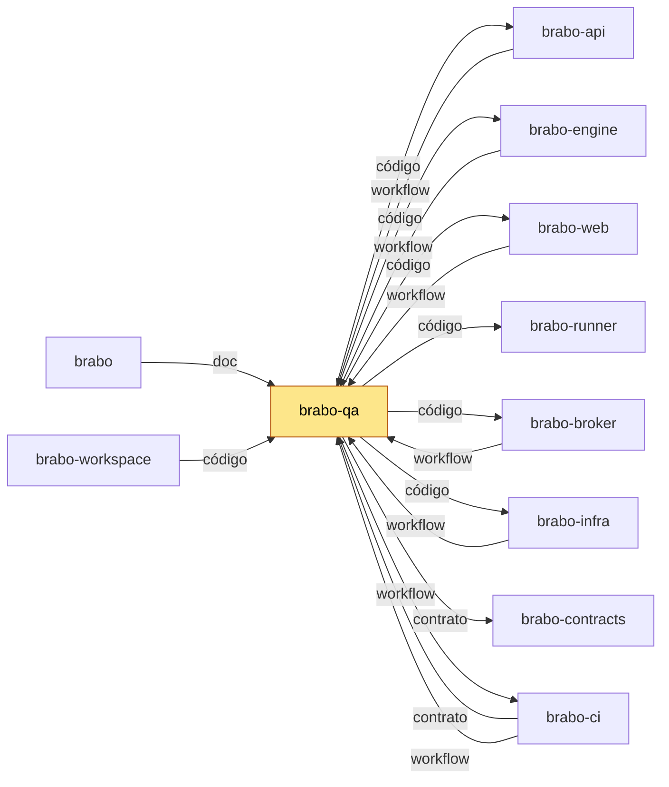

# brabo-qa

Testes que atravessam repositórios do Brabo: fluxo de navegador de ponta a ponta, golden-sets de RAG e QA e os instrumentos de medição.

## Para que existe

Prova o Brabo inteiro, de fora. Nenhum repo sozinho enxerga o fluxo que passa por api, engine e web ao mesmo tempo; este repo enxerga, e segura a PR para a `main` quando esse fluxo quebra.

## Onde se encaixa

Este repo é o portão de ponta a ponta. A PR para a `main` de `brabo-api`, `brabo-engine`, `brabo-web`, `brabo-broker`, `brabo-infra` e deste repo só entra com o check `E2E do brabo-qa` verde. Ele lê os irmãos em checkout ao lado e nunca copia o código deles.

<!-- mapa:inicio -->
<!-- Gerado do repos.yml do brabo por brabo-ci:scripts/ci/mapa-dos-repos.ts. Não edite à mão. -->

**brabo-qa** — E2E de navegador (Playwright), golden-sets e catálogo de funcionalidades — o portão da `main`. O brabo-ci dispara o `e2e-pr` dele e lê o `funcionalidades.yml`; api, engine, web, broker e infra o chamam como portão.

| repo | propósito | como é usado | depende de | é usado por |
|---|---|---|---|---|
| brabo | Porta de entrada do produto — documentação agregada, site, instalador e release. | Quem instala usa o `install.sh` e as imagens e o binário das tags de `componentes.json`; o brabo-infra o clona nas aferições cruzadas. | brabo-api (imagem, doc), brabo-engine (imagem, doc), brabo-web (imagem, doc), brabo-broker (imagem, doc), brabo-runner (imagem, doc), brabo-infra (imagem, código, doc), brabo-contracts (contrato, doc), brabo-ci (doc, workflow), brabo-qa (doc) | brabo-ci (contrato), brabo-infra (código), brabo-workspace (código) |
| brabo-api | API do produto (NestJS, Drizzle, PostgreSQL/pgvector) — schema, RBAC, LLM, metering e gates. | Imagem publicada por tag e consumida pelo brabo e pelo brabo-infra; o brabo-web, o brabo-engine e o brabo-qa leem o código ou o `openapi.json` dele. | brabo-contracts (contrato), brabo-infra (código), brabo-qa (workflow), brabo-ci (workflow) | brabo (imagem, doc), brabo-engine (código), brabo-web (contrato), brabo-contracts (contrato), brabo-infra (código), brabo-qa (código), brabo-workspace (código) |
| brabo-engine | Engine (Elixir/OTP, Phoenix, Oban) — agentes, sessões, gates e roteamento de runners. | Imagem publicada por tag, usada pelo brabo e pelo brabo-infra. | brabo-contracts (contrato), brabo-api (código), brabo-runner (código), brabo-qa (workflow), brabo-ci (workflow) | brabo (imagem, doc), brabo-infra (código), brabo-qa (código), brabo-workspace (código) |
| brabo-web | Interface web (React 19, Vite) — telas, i18n e design system. | Imagem publicada por tag, usada pelo brabo e pelo brabo-infra. | brabo-contracts (contrato), brabo-api (contrato), brabo-qa (workflow), brabo-ci (workflow) | brabo (imagem, doc), brabo-infra (código), brabo-qa (código), brabo-workspace (código) |
| brabo-runner | CLI `brabo-runner` na máquina do usuário — PTY, container local e espelho. | Binário publicado por tag, instalado pelo brabo; o brabo-engine e o brabo-qa leem o código dele nos testes. | brabo-contracts (contrato), brabo-ci (workflow) | brabo (imagem, doc), brabo-engine (código), brabo-infra (código), brabo-qa (código), brabo-workspace (código) |
| brabo-broker | Único processo com o socket do Docker do servidor. | Imagem publicada por tag, usada pelo brabo e pelo brabo-infra. | brabo-contracts (contrato), brabo-qa (workflow), brabo-ci (workflow) | brabo (imagem, doc), brabo-infra (código), brabo-qa (código), brabo-workspace (código) |
| brabo-contracts | Contratos compartilhados — os pacotes `shared` e `docker-port`, `areas.json` e `fluxo.yml`. | Consumido por TAG (pacote no GitHub Packages ou arquivo baixado por raw na mesma tag); uma tag nova pede bump em api, web, runner, broker, engine, qa e infra. | brabo-api (contrato), brabo-ci (workflow) | brabo (contrato, doc), brabo-api (contrato), brabo-engine (contrato), brabo-web (contrato), brabo-runner (contrato), brabo-broker (contrato), brabo-infra (código), brabo-qa (contrato), brabo-workspace (código) |
| brabo-ci | Workflows reutilizáveis e a política de PR, escada de aprovação, promoção, tag e Dependabot. | Cada repo chama `uses: viralabs-dev/brabo-ci/...@<sha>`, fixado por SHA. | brabo-qa (contrato, workflow), brabo (contrato) | brabo (doc, workflow), brabo-api (workflow), brabo-engine (workflow), brabo-web (workflow), brabo-runner (workflow), brabo-broker (workflow), brabo-contracts (workflow), brabo-infra (workflow), brabo-qa (workflow), brabo-workspace (código, workflow) |
| brabo-infra | Composes, Dockerfiles de integração, `deploy/k8s`, scripts de dev, release e cadeia de suprimentos. | O brabo clona o brabo-infra no ref de `componentes.json` para subir a instalação; o brabo-api e o brabo-qa o clonam no CI. | brabo-api (código), brabo-engine (código), brabo-web (código), brabo-broker (código), brabo-runner (código), brabo-contracts (código), brabo (código), brabo-qa (workflow), brabo-ci (workflow) | brabo (imagem, código, doc), brabo-api (código), brabo-qa (código), brabo-workspace (código) |
| **brabo-qa** | E2E de navegador (Playwright), golden-sets e catálogo de funcionalidades — o portão da `main`. | O brabo-ci dispara o `e2e-pr` dele e lê o `funcionalidades.yml`; api, engine, web, broker e infra o chamam como portão. | brabo-api (código), brabo-engine (código), brabo-web (código), brabo-runner (código), brabo-broker (código), brabo-infra (código), brabo-contracts (contrato), brabo-ci (workflow) | brabo (doc), brabo-api (workflow), brabo-engine (workflow), brabo-web (workflow), brabo-broker (workflow), brabo-ci (contrato, workflow), brabo-infra (workflow), brabo-workspace (código) |
| brabo-workspace | Pasta-mãe `~/dev/brabo/` com os clones lado a lado e o `clonar-tudo.sh`. | Quem desenvolve roda `clonar-tudo.sh` uma vez; as sessões do Claude abrem nela. | brabo (código), brabo-api (código), brabo-engine (código), brabo-web (código), brabo-runner (código), brabo-broker (código), brabo-contracts (código), brabo-ci (código, workflow), brabo-infra (código), brabo-qa (código) | — |


<!-- mapa:fim -->

## Como é usado

Este repo não é importado por ninguém. Os outros repos o usam pelo CI, de três jeitos:

- **Portão da `main`:** a PR de origem dispara o E2E contra o compose de produção do `brabo-infra`, sobre as imagens por digest, e o check `E2E do brabo-qa` fecha na própria PR. Detalhes em [`docs/e2e-portao/como-funciona.md`](docs/e2e-portao/como-funciona.md).
- **Golden-sets do engine:** o workflow copia `golden/engine/test/` para o `test/` do `brabo-engine` e roda o ExUnit contra o seed do `brabo-api`.
- **Layout da documentação:** o `brabo` usa este repo como referência do layout.

Exemplo copiável, que dispara uma rodada do golden-set de QA sob demanda no ambiente do CI (precisa do `gh` autenticado com acesso ao repo):

```bash
gh workflow run golden-set-qa.yml -R viralabs-dev/brabo-qa --ref dev
```

## Como desenvolver

Pré-requisitos: Node 26 e pnpm 11.3.0, os mesmos do CI. Os irmãos `brabo-*` ficam ao lado deste repo (o `brabo-workspace` clona todos). Os scripts leem o código deles.

```bash
# scripts: typecheck e specs (com os irmãos ao lado)
pnpm --dir scripts install --frozen-lockfile
pnpm --dir scripts typecheck
pnpm --dir scripts test

# e2e: no PR, só o typecheck (o teste de navegador é manual)
pnpm --dir e2e install --frozen-lockfile
pnpm --dir e2e typecheck
```

| Pasta | O que é |
| --- | --- |
| `e2e/` | Playwright, só chromium (ADR 0120). Lockfile próprio; não é membro de workspace. |
| `golden/engine/test/` | Golden-sets ExUnit e os `floor.json`. Rodam dentro do `brabo-engine`. |
| `scripts/jev/`, `scripts/idioma/` | Instrumentos de medição. Leem e reexportam fontes de `brabo-api` e `brabo-engine` em checkout irmão; nunca copiam. |
| `.github/workflows/` | `ci` e `e2e-pr` (PR), `golden-set-*` (agendados, ADR 0138/0168). |

O E2E manual e o estado dos golden-sets estão em [`docs/rodadas-manuais.md`](docs/rodadas-manuais.md).

## O que o CI garante

No PR deste repo, o workflow `ci` roda:

- **scripts:** typecheck e specs dos scripts, com os irmãos ao lado;
- **e2e:** typecheck do Playwright;
- **cadeia:** actionlint e pins do `brabo-ci`;
- **Caminhos dos irmãos:** confere que os arquivos que os golden-sets pedem aos irmãos existem.

O portão da `main` vive nas PRs dos outros repos: o check `E2E do brabo-qa` fica vermelho se o E2E quebrar, e `/qa-aceitar <justificativa>` (só o dono) aceita um vermelho por `spec`, `ambiente` ou `sem-resposta`. Quem tem escrita neste repo pode aprovar esse portão: trate o acesso daqui como o de um aprovador.

O regressivo por funcionalidade (`funcionalidades.yml`, validado por `scripts/ci/funcionalidades.ts`) mapeia caminhos de cada repo para as 16 funcionalidades do Brabo. Funcionalidade sem spec aparece como "sem cobertura" e não reprova. Detalhes em [`docs/regressivo/como-funciona.md`](docs/regressivo/como-funciona.md).

## Documentação

- [`docs/e2e-portao/como-funciona.md`](docs/e2e-portao/como-funciona.md): o portão da `main`, com o `fechar`, o token do App e os prints.
- [`docs/regressivo/como-funciona.md`](docs/regressivo/como-funciona.md): o regressivo por funcionalidade e o relatório de decisão.
- [`docs/rodadas-manuais.md`](docs/rodadas-manuais.md): E2E de navegador manual e golden-sets agendados.
- [`CHANGELOG.md`](CHANGELOG.md), [`funcionalidades.yml`](funcionalidades.yml) e [`CLAUDE.md`](CLAUDE.md).
- Documentação central do Brabo: [repo `brabo`](https://github.com/viralabs-dev/brabo) e [página do produto](https://viralabs-dev.github.io/brabo/prd/).
- O histórico veio do monorepo `brabo-legacy` (ADR 0252). Os `#N` nos commits apontam para lá.

## Como replicar no seu projeto

O que serve a outro projeto é o padrão, não os testes do Brabo:

- o portão de PR cruzado (`e2e-pr.yml`): o job `fechar` faz checkout limpo da `dev` e só então cria o token do App, com escrita restrita ao repo validado;
- o regressivo por funcionalidade (`funcionalidades.yml` com `scripts/ci/funcionalidades.ts`).

Copie os dois, troque os repos e os caminhos, e adapte o catálogo de funcionalidades ao seu produto. O guia de adoção é o [`adotar.md` do brabo-ci](https://github.com/viralabs-dev/brabo-ci/blob/dev/scripts/ci/docs/tutorials/adotar.md).

## Apoie

Se o projeto te ajuda, você pode [pagar um café no Ko-fi](https://ko-fi.com/daneiel).

## Licença

MIT. Veja o [LICENSE](LICENSE).
