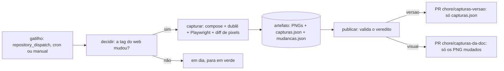

# Capturas da doc

O `brabo-qa` fotografa as telas que a documentação do `brabo` mostra (AT-859, ADR 0286 do `brabo`). A imagem acompanha a interface sem depender de alguém lembrar, e nenhum dado pessoal sai nela (AT-864).

**Para quem é:** quem mantém a doc do `brabo` e quem revisa a PR das capturas. **O que a pessoa consegue fazer depois:** rodar o cenário na própria máquina, ler a PR do bot e saber por que ela aparece. **Como se prova:** o spec da guarda (`scripts/ci/ocultar.spec.ts`) falha com um texto `/home/x`, e o job `capturar` roda o cenário inteiro contra as imagens.

## Como funciona



- **Gatilhos:** o `repository_dispatch` `capturas-pin-mudou` (o `brabo` o dispara quando a pin do `web` muda na `dev`, AT-878), o cron diário e o `workflow_dispatch` (com `forcar`).
- **`decidir`** compara a pin do `web` em `componentes.json` do `brabo` (na `dev`) com o `web` de `docs/assets/capturas.json`. Mesma TAG: para em verde ("em dia"). Tag diferente, PATCH incluso: segue, porque a tela decide se há PR, não a versão. Sem manifesto, segue.
- **`capturar`** não tem o token do App. Sobe o compose do `brabo-infra` com as imagens por digest (tag resolvida uma vez, `cosign verify` antes), liga o provider dublê da api com o roteiro DIDÁTICO deste repo (`e2e/capturas/roteiro.json`, um encurtador de links) e roda `e2e/playwright.capturas.config.ts`. Depois baixa os PNG atuais de `raw.githubusercontent.com/viralabs-dev/brabo/dev` (repo público, sem token) e roda `capturas.ts diferenca`: cada PNG novo contra o da `dev`, com `pixelmatch` (`threshold: 0.1`) e o limiar de 0,02% dos pixels (`LIMIAR = 0.0002`, ≈210 px em 1366×768). O veredito vai em `mudancas.json`, no artefato: `versao` (nada passou do limiar) ou `visual` (a lista dos PNG que passaram, com a fração). PNG novo, removido ou de outro tamanho conta como mudança.
- **`publicar`** é o único job com o token do App (`repositories: brabo`, `contents: write`, `pull-requests: write`). Faz checkout limpo do `brabo` na `dev`, baixa o artefato e VALIDA na fronteira de confiança (`scripts/ci/capturas.ts validar <pasta> veredito`): só `.png` com nome do manifesto, cada um com até 400 KB, o JSON conferido e o `mudancas.json` bem formado e coerente. Nenhum PNG entra se o veredito for `versao`. Dois caminhos, com a mesma App:
  - **`versao`:** só `docs/assets/capturas.json` (os campos `web`, `api`, `engine` e `data`), na branch `chore/capturas-versao`, título "docs: as capturas da doc conferem com o web vX.Y.Z". A isenção da escada para essa branch é do `brabo-ci`, e o `capturas-check` do `brabo` reprova se a PR tocar outra coisa.
  - **`visual`:** só os PNG listados em `mudancas.json` mais o manifesto, na branch `chore/capturas-da-doc`. A PR passa pela escada INTEIRA do `brabo-ci`, o corpo lista os arquivos e a fração de cada um, e a aprovação do dono é a conferência com zoom da AT-864.
  - Cada caminho fecha a PR do outro (o veredito mais novo a substitui), e fecha a sua quando não há diferença.

## O cenário

`e2e/capturas/doc.captura.ts` não é spec: não leva `@f-`, mora fora de `e2e/testes/` e só roda pela config própria, que o `pnpm test` e o portão da `main` não enxergam. Cada tela sai em 1366×768, nos temas claro e escuro, em `<nome>-<tema>.png`, mais `capturas.json` com `arquivo`, `tela`, `tema`, `web`, `api`, `engine` e `data`.

| Captura | Tela |
| --- | --- |
| `projetos` | lista de projetos |
| `novo-projeto` | assistente de novo projeto |
| `modelo-do-time` | modelos por agente, nas configurações |
| `ideia-no-chat` | o Criativo respondendo (dublê) |
| `perguntas-abertas` | a fila de perguntas abertas |
| `providers` | provedores de modelo, sem chave |
| `gastos` | consumo do projeto |
| `adr-no-chat` | o ADR que o Arquiteto propôs, pendente para o dono (passo 4) |
| `arquitetura` | a aba Arquitetura: mapa de módulos, C4 e ADR (README) |
| `plano-e-modo-automatico` | o plano do Dev Lead pendente e a oferta do modo automático (passo 5) |
| `dev-agent` | o fio da execução: o dev agent pega a tarefa e entrega a PR (README) |
| `merges-no-chat` | a PR pronta na fila do chat, para o dono mergear (passo 6 e README) |

As cinco últimas (AT-872) vêm de estado semeado por HTTP, sem turno de LLM: `proporAdr` e `proporPlanoDoDevLead` propõem a ação como agente e exigem que nasça `pending`, e `semearExecucao({ name })` cria a execução com o dev Noop. Nada é aprovado (aprovar o ADR abriria PR; aprovar o plano ativaria dev real) e nada é mergeado. A ordem no arquivo importa: os testes de execução criam outro projeto, e as telas do chat precisam sair antes de o plano ser proposto. Por isso o engine das capturas é a `-dev.N` mais nova (ou o `engine_tag` do dispatch), como a api: o dev Noop só pega a tarefa sem container registrado nas `-dev` (engine#58). O passo "Capturar" roda sob `scripts/ci/com-token-de-servico.sh` porque a semeadura usa rotas internas (`E2E_SERVICE_TOKEN`).

- **Conta:** `owner@brabo.dev`, a do seed do compose de produção (fictícia). O acesso rápido (`<papel>@brabo.dev`) não serve: só existe em imagem sem a marca (RN-984, ADR 0245), e a doc descreve a imagem da release.
- **O dublê** só carrega em imagem sem a marca `prd` (RN-1065). Por isso a api das capturas é a `-dev.N` mais nova (ou a `api_tag` do dispatch), e as outras três imagens (web, broker, backup) seguem as pins; o engine também é a `-dev.N` mais nova (AT-872). O manifesto grava a tag que de fato rodou.
- **Um login só.** Os dois temas saem do mesmo contexto: o refresh do login vale uma vez, e navegar com a renovação em voo a aborta e derruba a sessão (por isso o `fotografar` espera a rede assentar antes de recarregar).

## A ocultação (AT-864)

`e2e/suporte/ocultar.ts` tem duas camadas:

1. **`mask`:** o `page.screenshot({ mask })` cobre com cor chapada o e-mail e o nome do usuário (o botão do menu da barra lateral), campos de senha, e-mail, chave, token e caminho. Os seletores são estruturais, nunca texto.
2. **Guarda de texto:** `conferirSemDadoSensivel` LANÇA antes do screenshot se o texto visível ou o valor de um campo casar com `/home/`, o usuário da máquina, o handle do GitHub, um token (`ghp_`, `github_pat_`, `sk-`, JWT, chave AWS) ou um e-mail fora dos domínios de teste (`brabo.dev`, `brabo.test`, `loja-teste.local`, `exemplo.com`, `bot.brabo.local`, o e-mail fictício que o worktree do dev agent grava). A mensagem diz o TIPO do achado, nunca o trecho: ela vai para log de Actions.

### O que muda a cada execução (AT-878)

O diff de pixels só presta se duas capturas do mesmo build saírem iguais. Por isso `fixarNaPagina` (em `ocultar.ts`) troca, nos nós de texto e antes do screenshot, o que é de cada execução: o hash curto da sessão (`#425583c8`), o hash da branch da tarefa (`task-bb58781d`), o "iniciada às HH:MM:SS" e o "há N min". Antes dessa troca, o ruído ia de 0,02% a 0,48% dos pixels, acima do limiar. Ela também espera o texto e as rolagens assentarem (o feed do chat media linhas depois do carregamento). O que a tela mostra de verdade continua igual, e a lista de padrões (`VOLATEIS`) tem spec. Ao achar outro valor que muda sozinho, acrescente-o lá.

A captura não é repetida até passar (`retries: 0`). A guarda cobre o que a página mostra; o que a imagem tem de visual (um nome dentro de um gráfico, por exemplo) só a leitura com zoom pega.

## Rodar na máquina

```bash
# compose de teste com o dublê (-f suporte/compose-duble.yml) e o seed do owner@brabo.dev
cd e2e
E2E_WEB_URL=http://localhost:8088 E2E_API_URL=http://localhost:3000 \
CAPTURAS_WEB=v1.2.1 CAPTURAS_API=v2.2.0-dev.21 CAPTURAS_ENGINE=v2.1.0 \
  pnpm exec playwright test -c playwright.capturas.config.ts
```

A saída vai para `e2e/capturas/saida/` (ignorada pelo git), ou para `CAPTURAS_SAIDA`. Nunca use o Postgres da instalação.

Para ver o veredito entre duas pastas de capturas (precisa de `pnpm --dir scripts install`):

```bash
node scripts/ci/capturas.ts diferenca <pasta-atual> <pasta-nova> <mudancas.json>   # imprime veredito=versao|visual e os PNG
```

## Ligar a publicação

O job `publicar` só roda com a variável do repositório `CAPTURAS_PUBLICAR=true`, que não existe. Antes de criá-la:

1. Rode o `capturar` por `workflow_dispatch` e leia as imagens do artefato com zoom, nos dois temas.
2. TODO(humano): confirmar que a instalação do App `viralabs-dev-brabo` no `brabo` concede `contents: write` e `pull-requests: write`. O `regenera-gerados.yml` já abre PR lá, mas isso não prova as duas permissões para o token mintado aqui.
3. TODO(humano): decidir se a api das capturas pode ser a `-dev.N` mais nova (padrão) ou se o dublê passa a carregar também em imagem `prd` (contraria a RN-1065).
